# FFXIV Mods

Characters from other games ported into **Final Fantasy XIV** as [Penumbra](https://github.com/xivdev/Penumbra) mods, plus the tools, plugins and apps built along the way.


**[⬇ Download the mods](../../releases/tag/mods)** · **[⬇ Download the apps](../../releases/tag/apps)** · [How to install](#installing-a-mod) · [Tools and apps](#tools-and-apps) · [How a port is made](#how-a-port-is-made)

## Mods

<!-- mods:start -->
32 mods. Each one has its own readme with what to wear and how it was made.

<table>
<tr><td width="33%" valign="top"><a href="Aerith/out/README.md">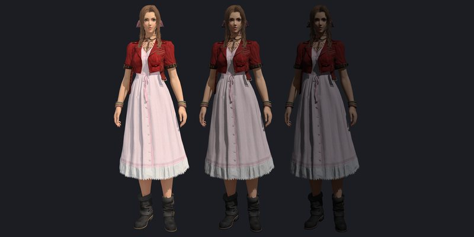</a><br><b>Aerith Gainsborough (FF7 Remake)</b> <sub>v1.8.0</sub><br><sub>Aerith's outfit from Final Fantasy VII Remake Intergrade, refit for FFXIV women (Midlander, Highlander, Elezen, Miqo'te, Roegadyn, Au Ra, Hrothgar, Viera) on Bibo+ (Medium).</sub><br><a href="../../releases/download/mods/Aerith-Gainsborough-FF7R.pmp">⬇ Download</a> · <a href="Aerith/out/README.md">Readme</a></td><td width="33%" valign="top"><a href="Asuka/README.md"></a><br><b>Asuka Langley (Evangelion)</b> <sub>v1.2.0</sub><br><sub>Asuka Langley in her red plugsuit (Evangelion), as a full-body costume on the Magitek set.</sub><br><a href="../../releases/download/mods/Asuka-Langley-Evangelion.pmp">⬇ Download</a> · <a href="Asuka/README.md">Readme</a></td><td width="33%" valign="top"><a href="Asuka/README.md">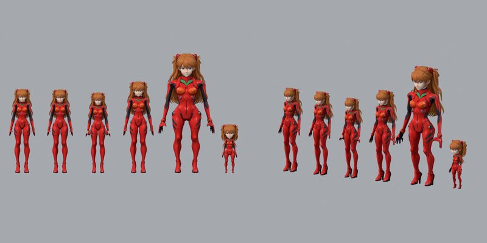</a><br><b>Asuka Plugsuit (Evangelion)</b> <sub>v1.2.0</sub><br><sub>Asuka Langley's red plugsuit (Evangelion) on your own character: your head, face and hair stay.</sub><br><a href="../../releases/download/mods/Asuka-Plugsuit-Evangelion.pmp">⬇ Download</a> · <a href="Asuka/README.md">Readme</a></td></tr>
<tr><td width="33%" valign="top"><a href="BlackCat/README.md">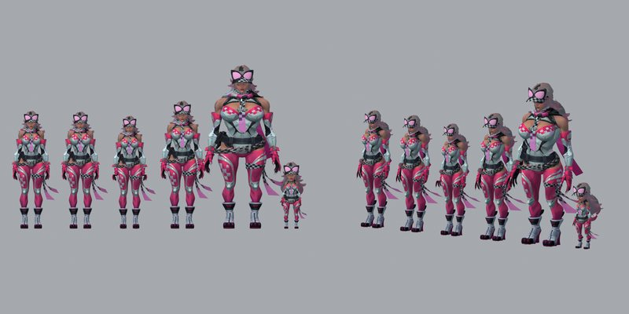</a><br><b>Black Cat - Pink Purr (Marvel Rivals)</b> <sub>v1.1.0</sub><br><sub>Black Cat from Marvel Rivals in her Pink Purr costume, as a full-body costume on the Street set.</sub><br><a href="../../releases/download/mods/Black-Cat-Pink-Purr-Marvel-Rivals.pmp">⬇ Download</a> · <a href="BlackCat/README.md">Readme</a></td><td width="33%" valign="top"><a href="CloudFF7R/README.md">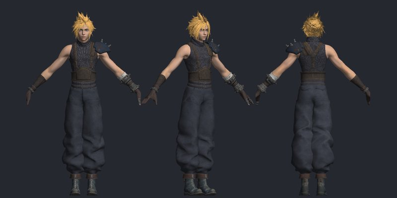</a><br><b>Cloud Strife (FF7R) - Strife Set</b> <sub>v1.1.0</sub><br><sub>Cloud Strife from Final Fantasy VII Remake Intergrade, ported onto the Hyur Midlander male skeleton so every FFXIV animation and emote drives him.</sub><br><a href="../../releases/download/mods/Cloud-Strife-FF7R-Strife-Set.pmp">⬇ Download</a> · <a href="CloudFF7R/README.md">Readme</a></td><td width="33%" valign="top"><b>Don Quixote (Limbus Company) - Full Body</b> <sub>v1.3.0</sub><br><sub>Full body replacement of Don Quixote from Limbus Company for Hyur Midlander female.</sub><br><a href="../../releases/download/mods/DonQuixote.pmp">⬇ Download</a> · <a href="DonQuixote/README.md">Readme</a></td></tr>
<tr><td width="33%" valign="top"><b>Don Quixote (Limbus Company) - Outfit (Viera Male)</b> <sub>v1.2.0</sub><br><sub>Don Quixote's coat, shirt, tie, trousers and boots refitted for Viera male. Your own head, ears, hair and hands stay.</sub><br><a href="../../releases/download/mods/DonQuixote-Outfit-VieraMale.pmp">⬇ Download</a> · <a href="DonQuixote/README.md">Readme</a></td><td width="33%" valign="top"><a href="Gekko/README.md">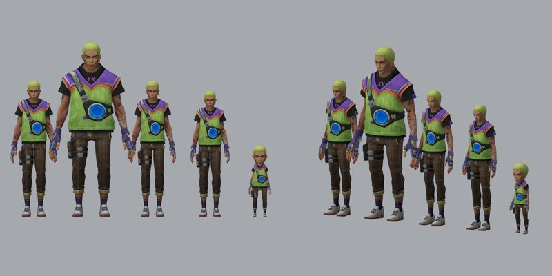</a><br><b>Gekko (Valorant)</b> <sub>v1.2.0</sub><br><sub>Gekko from VALORANT, as a full-body costume on the Alternative set.</sub><br><a href="../../releases/download/mods/Gekko-Valorant.pmp">⬇ Download</a> · <a href="Gekko/README.md">Readme</a></td><td width="33%" valign="top"><a href="Gregor/README.md">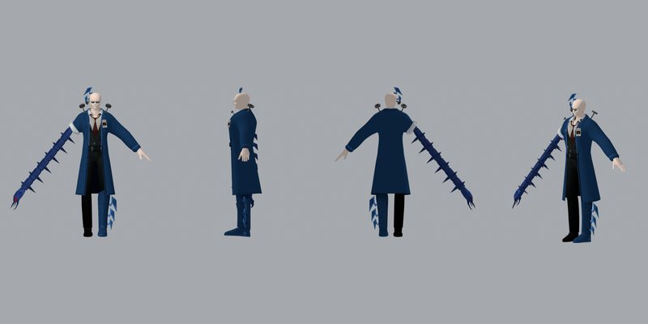</a><br><b>Gregor AEDD (Limbus Company)</b> <sub>v1.1.1</sub><br><sub>Gregor's AEDD outfit from Limbus Company, ported from the VRChat avatar "AEDD Gregor" for Hyur Midlander male and every male race that wears Midlander gear, Viera included. It keeps your own head, face, hair, ears and skin.</sub><br><a href="../../releases/download/mods/Gregor-AEDD-Limbus-Company.pmp">⬇ Download</a> · <a href="Gregor/README.md">Readme</a></td></tr>
<tr><td width="33%" valign="top"><b>Griffith (Reborn)</b> <sub>v1.1.0</sub><br><sub>Griffith (Reborn) from BERSERK and the Band of the Hawk, rigged to the FFXIV Hyur Midlander male skeleton.</sub><br><a href="../../releases/download/mods/Griffith-Reborn.pmp">⬇ Download</a> · <a href="Griffith/README.md">Readme</a></td><td width="33%" valign="top"><a href="HeroChaosChao/README.md">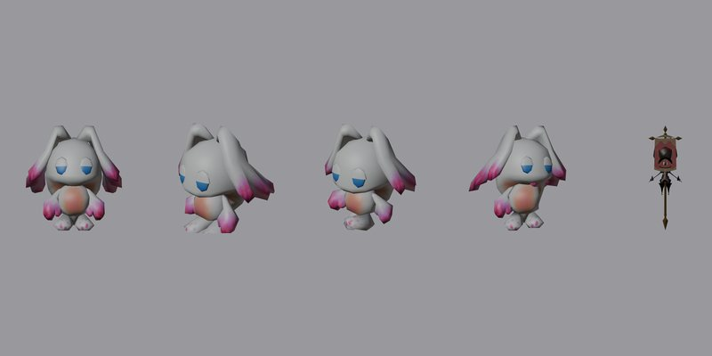</a><br><b>Hero Chaos Chao (Mammet #001)</b> <sub>v1.1.0</sub><br><sub>The Hero Chaos Chao from Sonic Adventure 2: Battle as the Mammet #001 minion.</sub><br><a href="../../releases/download/mods/Hero-Chaos-Chao-Mammet-001.pmp">⬇ Download</a> · <a href="HeroChaosChao/README.md">Readme</a></td><td width="33%" valign="top"><a href="InvisibleWoman/README.md">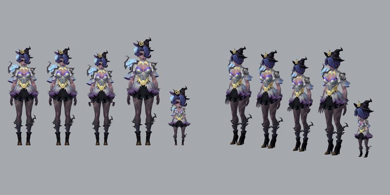</a><br><b>Invisible Woman - Unseen Weaver (Marvel Rivals)</b> <sub>v1.2.0</sub><br><sub>Invisible Woman (Sue Storm) from Marvel Rivals in her Unseen Weaver skin, as a full-body costume on the Valentione Rose Ribboned set.</sub><br><a href="../../releases/download/mods/Invisible-Woman-Unseen-Weaver-Marvel-Rivals.pmp">⬇ Download</a> · <a href="InvisibleWoman/README.md">Readme</a></td></tr>
<tr><td width="33%" valign="top"><a href="JakII/README.md">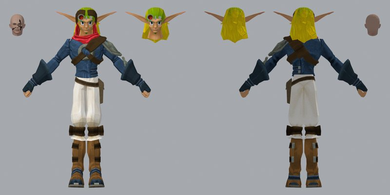</a><br><b>Jak (Jak II)</b> <sub>v1.1.0</sub><br><sub>Jak from Jak II (PS2), rigged to the FFXIV Hyur Midlander male skeleton.</sub><br><a href="../../releases/download/mods/Jak-Jak-II.pmp">⬇ Download</a> · <a href="JakII/README.md">Readme</a></td><td width="33%" valign="top"><a href="JotaroP4/README.md">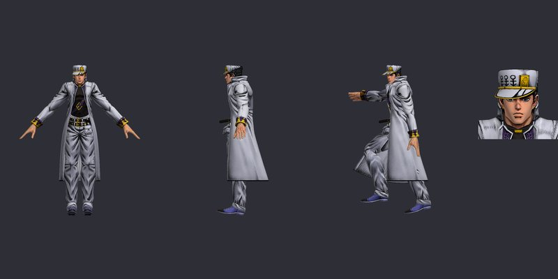</a><br><b>Jotaro Kujo (Part 4)</b> <sub>v1.2.0</sub><br><sub>Jotaro Kujo (Part 4, Diamond is Unbreakable) from JoJo's Bizarre Adventure: Eyes of Heaven, re-rigged to the FFXIV skeleton.</sub><br><a href="../../releases/download/mods/Jotaro-Kujo-Part-4.pmp">⬇ Download</a> · <a href="JotaroP4/README.md">Readme</a></td><td width="33%" valign="top"><a href="Jubilee/README.md">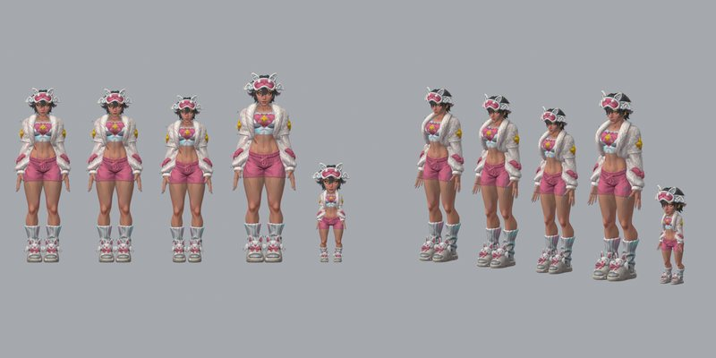</a><br><b>Jubilee - Vampy Jammies (Marvel Rivals)</b> <sub>v1.1.0</sub><br><sub>Jubilee from Marvel Rivals in her Vampy Jammies skin, as a full-body costume on the Pajama set.</sub><br><a href="../../releases/download/mods/Jubilee-Vampy-Jammies-Marvel-Rivals.pmp">⬇ Download</a> · <a href="Jubilee/README.md">Readme</a></td></tr>
<tr><td width="33%" valign="top"><a href="LadyLoki/README.md">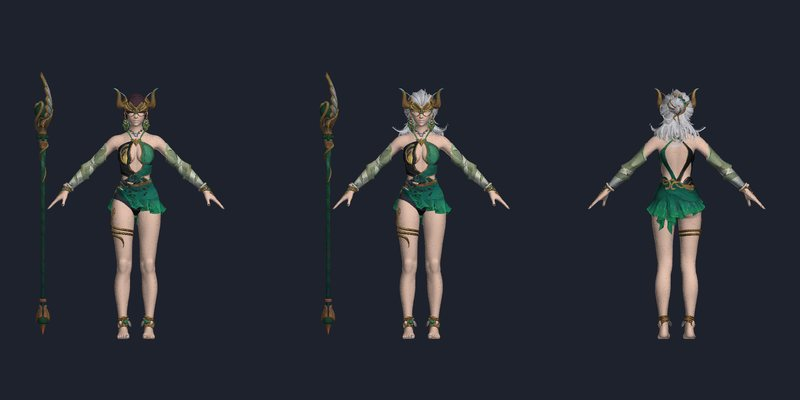</a><br><b>Lady Loki - Seaside Siren (Marvel Rivals)</b> <sub>v1.1.1</sub><br><sub>Lady Loki's Seaside Siren outfit from Marvel Rivals, fitted to Bibo+ (feminine c0201 races, incl. Au Ra/Miqo'te/Elezen/Viera via racial deformation).</sub><br><a href="../../releases/download/mods/LadyLoki-Lady-Loki-Seaside-Siren-Marvel-Rivals.pmp">⬇ Download</a> · <a href="LadyLoki/README.md">Readme</a></td><td width="33%" valign="top"><a href="LadyLoki/README.md"></a><br><b>Seaside Siren (Lady Loki outfit) - Isle Vacationer's</b> <sub>v1.1.1</sub><br><sub>Lady Loki's Seaside Siren outfit from Marvel Rivals on Bibo+, as a separate pack from the Lady Loki mod so both can be enabled at once. Built on the c0201 (Midlander female) body; other feminine c0201 races get it via racial deformation.</sub><br><a href="../../releases/download/mods/Seaside-Siren-Isle-Vacationer-s-Ebony-Staff.pmp">⬇ Download</a> · <a href="LadyLoki/README.md">Readme</a></td><td width="33%" valign="top"><a href="LichKing/README.md">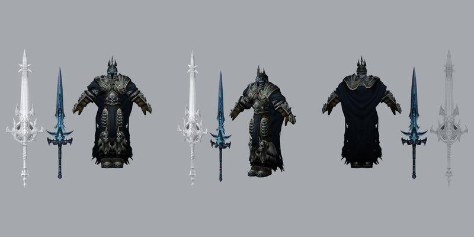</a><br><b>The Lich King (WoW)</b> <sub>v1.1.0</sub><br><sub>Arthas Menethil as the Lich King, from the World of Warcraft model, with his WoW armour fitted to the FFXIV Hyur Midlander male skeleton.</sub><br><a href="../../releases/download/mods/The-Lich-King-WoW.pmp">⬇ Download</a> · <a href="LichKing/README.md">Readme</a></td></tr>
<tr><td width="33%" valign="top"><a href="Loki/README.md">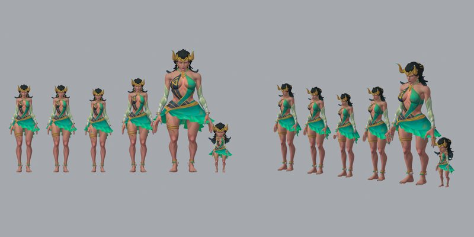</a><br><b>Lady Loki - Seaside Siren (Marvel Rivals)</b> <sub>v1.4.0</sub><br><sub>Lady Loki from Marvel Rivals in her Seaside Siren swimsuit, as a full-body costume on the Summer's Flame set.</sub><br><a href="../../releases/download/mods/Loki-Lady-Loki-Seaside-Siren-Marvel-Rivals.pmp">⬇ Download</a> · <a href="Loki/README.md">Readme</a></td><td width="33%" valign="top"><a href="LunaSnow/README.md">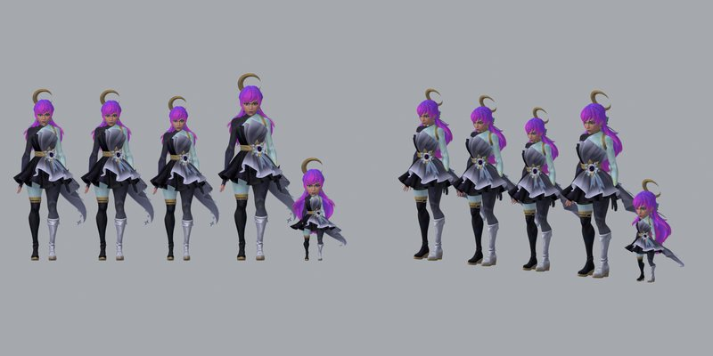</a><br><b>Luna Snow - Coalsack Nebula (Marvel Rivals)</b> <sub>v1.1.0</sub><br><sub>Luna Snow from Marvel Rivals in her Coalsack Nebula skin, as a full-body costume on the Cosmic Explorer's set.</sub><br><a href="../../releases/download/mods/Luna-Snow-Coalsack-Nebula-Marvel-Rivals.pmp">⬇ Download</a> · <a href="LunaSnow/README.md">Readme</a></td><td width="33%" valign="top"><a href="Mantis/README.md">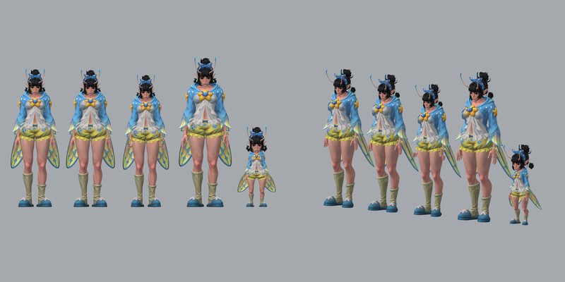</a><br><b>Mantis - Dreamy Dew (Marvel Rivals)</b> <sub>v1.2.0</sub><br><sub>Mantis in her Dreamy Dew pyjamas from Marvel Rivals, as a full-body costume on The Warden's set.</sub><br><a href="../../releases/download/mods/Mantis-Dreamy-Dew-Marvel-Rivals.pmp">⬇ Download</a> · <a href="Mantis/README.md">Readme</a></td></tr>
<tr><td width="33%" valign="top"><a href="Mina/README.md">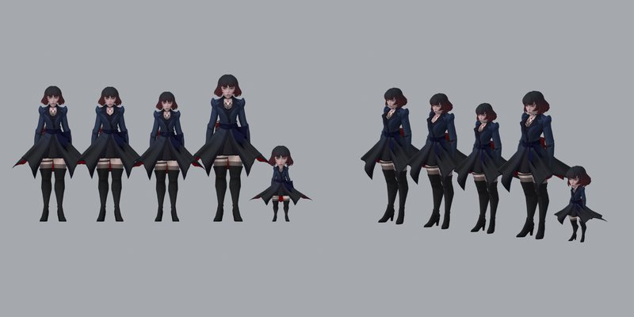</a><br><b>Mina (Deadlock)</b> <sub>v1.3.0</sub><br><sub>Mina from Deadlock, as a full-body costume on the Alternative set.</sub><br><a href="../../releases/download/mods/Mina-Deadlock.pmp">⬇ Download</a> · <a href="Mina/README.md">Readme</a></td><td width="33%" valign="top"><a href="Neon/README.md">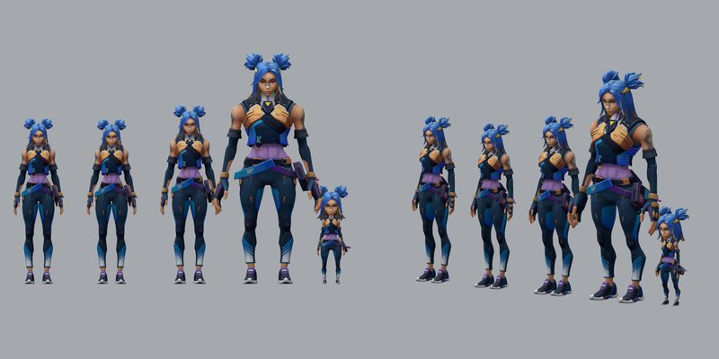</a><br><b>Neon (Valorant)</b> <sub>v1.2.0</sub><br><sub>Neon from Valorant, as a full-body costume on the Critical Hit B Tour set.</sub><br><a href="../../releases/download/mods/Neon-Valorant.pmp">⬇ Download</a> · <a href="Neon/README.md">Readme</a></td><td width="33%" valign="top"><a href="NursePool/README.md">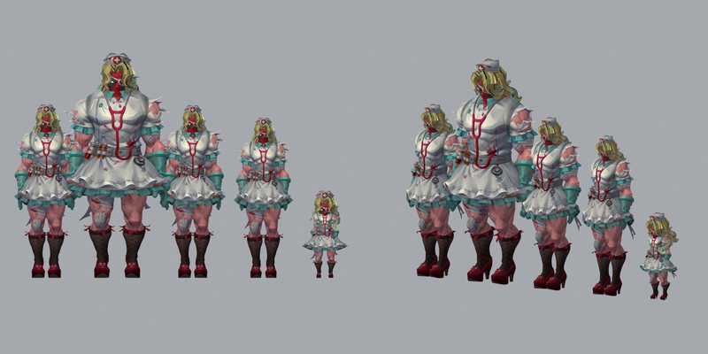</a><br><b>Nurse-Pool (Marvel Rivals)</b> <sub>v1.3.0</sub><br><sub>Deadpool's Nurse-Pool skin from Marvel Rivals, as a full-body costume on the Housemaid's set.</sub><br><a href="../../releases/download/mods/Nurse-Pool-Marvel-Rivals.pmp">⬇ Download</a> · <a href="NursePool/README.md">Readme</a></td></tr>
<tr><td width="33%" valign="top"><a href="PeniParker/README.md">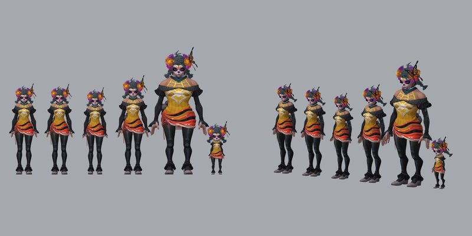</a><br><b>Peni Parker - Floral Frights (Marvel Rivals)</b> <sub>v1.0.3</sub><br><sub>Peni Parker in her Floral Frights skin from Marvel Rivals (just Peni, no SP//dr), as a full-body costume on the Night of Devilry set.</sub><br><a href="../../releases/download/mods/Peni-Parker-Floral-Frights-Marvel-Rivals.pmp">⬇ Download</a> · <a href="PeniParker/README.md">Readme</a></td><td width="33%" valign="top"><a href="SailorMoon/README.md">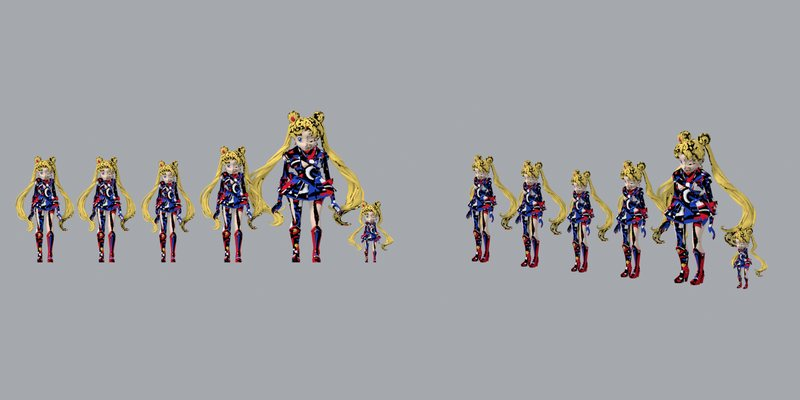</a><br><b>Sailor Moon (figure)</b> <sub>v1.2.0</sub><br><sub>Sailor Moon, from a 3D-print figure sculpt, as a full-body costume.</sub><br><a href="../../releases/download/mods/Sailor-Moon-figure.pmp">⬇ Download</a> · <a href="SailorMoon/README.md">Readme</a></td><td width="33%" valign="top"><a href="SonicForces/README.md">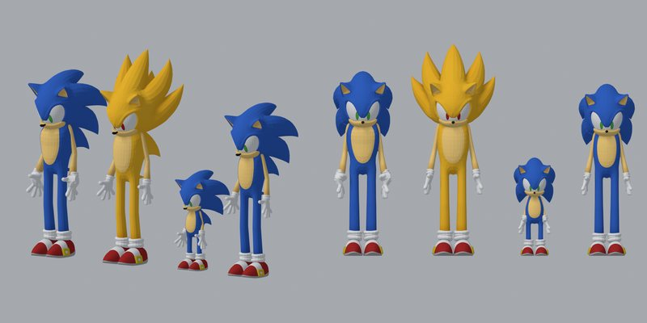</a><br><b>Sonic the Hedgehog (Sonic Forces)</b> <sub>v1.1.1</sub><br><sub>Sonic the Hedgehog from Sonic Forces, as a full-body costume on the Werewolf set.</sub><br><a href="../../releases/download/mods/Sonic-the-Hedgehog-Sonic-Forces.pmp">⬇ Download</a> · <a href="SonicForces/README.md">Readme</a></td></tr>
<tr><td width="33%" valign="top"><a href="SoraKH3/README.md">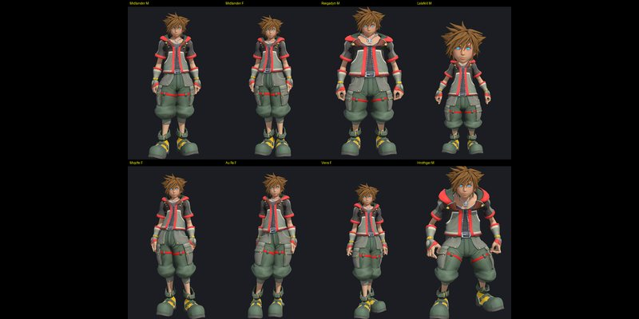</a><br><b>Sora (Kingdom Hearts III)</b> <sub>v2.0.0</sub><br><sub>Sora from Kingdom Hearts III, as a full-body costume on the Air Cell set.</sub><br><a href="../../releases/download/mods/Sora-KH3.pmp">⬇ Download</a> · <a href="SoraKH3/README.md">Readme</a></td><td width="33%" valign="top"><a href="SwiftSpectralTiger/README.md">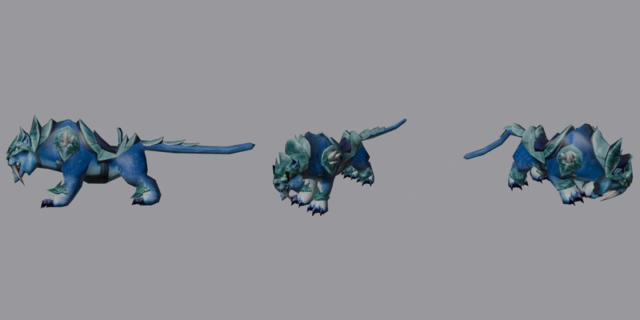</a><br><b>Swift Spectral Tiger</b> <sub>v1.1.0</sub><br><sub>The Swift Spectral Tiger from World of Warcraft as an FFXIV mount, rigged to the FFXIV tiger skeleton.</sub><br><a href="../../releases/download/mods/Swift-Spectral-Tiger.pmp">⬇ Download</a> · <a href="SwiftSpectralTiger/README.md">Readme</a></td><td width="33%" valign="top"><a href="Viper/README.md">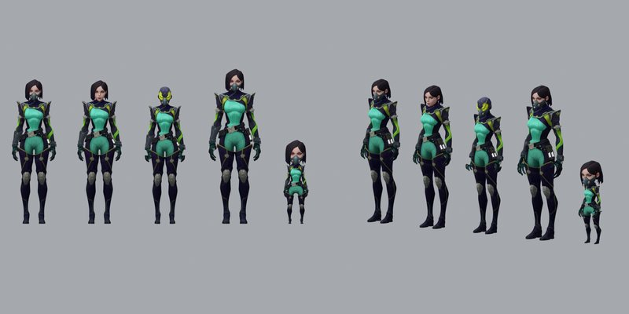</a><br><b>Viper (Valorant)</b> <sub>v1.1.1</sub><br><sub>Viper from Valorant, as a full-body costume on the Scientist's set.</sub><br><a href="../../releases/download/mods/Viper-Valorant.pmp">⬇ Download</a> · <a href="Viper/README.md">Readme</a></td></tr>
<tr><td width="33%" valign="top"><a href="VoidwingDragonhawk/README.md">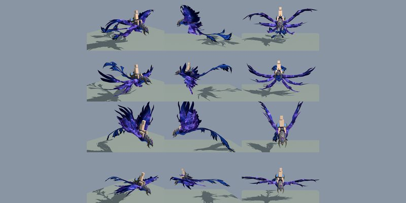</a><br><b>Voidwing Dragonhawk (Company Chocobo)</b> <sub>v1.3.0</sub><br><sub>The Voidwing Dragonhawk (World of Warcraft: Midnight, Epic Edition mount) as your chocobo.</sub><br><a href="../../releases/download/mods/Voidwing-Dragonhawk-Company-Chocobo.pmp">⬇ Download</a> · <a href="VoidwingDragonhawk/README.md">Readme</a></td><td width="33%" valign="top"><a href="WhiteFox/README.md">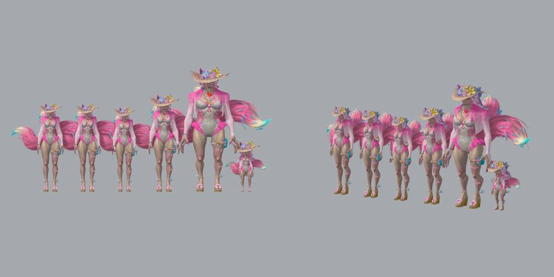</a><br><b>White Fox - Pink Paws (Marvel Rivals)</b> <sub>v1.2.1</sub><br><sub>White Fox from Marvel Rivals in her Pink Paws costume, as a full-body costume on the Island Resort set.</sub><br><a href="../../releases/download/mods/White-Fox-Pink-Paws-Marvel-Rivals.pmp">⬇ Download</a> · <a href="WhiteFox/README.md">Readme</a></td></tr>
</table>
<!-- mods:end -->

Still in the works: **Jehuty** (Zone of the Enders). The project is set up but has no build yet.

## Installing a mod

1. Install [XIVLauncher](https://goatcorp.github.io/) with Dalamud, then the **Penumbra** and **Glamourer** plugins.
2. Download the mod's `.pmp` from the [mods release](../../releases/tag/mods).
3. In Penumbra, click **Import Mod**, pick the `.pmp`, and enable it in your character's collection.
4. Wear the gear the mod's readme lists. Most mods come with a Glamourer design: copy the code from `out/<Name> - Glamourer import code.txt` in the project folder and use **Import design from clipboard** in Glamourer. Glamourer can put gear on even if you don't own it.
5. If anything doesn't change, type `/penumbra redraw`.

There are two kinds of mod here:

- **Full-body costumes** replace your whole character, head included. The character is fitted to the game's skeletons, so it moves with the game's own animations. Most work on every race. A few are made for one race, and their readme says which.
- **Outfits** replace only the clothes. You keep your own face, hair and body (some need the Bibo+ body mod). Lady Loki (outfit), Gregor, the Asuka Plugsuit, Aerith and the Don Quixote Viera outfit work this way.

Two are not gear at all: **Hero Chaos Chao** replaces the Mammet #001 minion, and **Voidwing Dragonhawk** and **Swift Spectral Tiger** replace mounts.

## Tools and apps

| Project | What it is |
|---|---|
| [PMP Viewer](PmpViewer/README.md) | Tests a `.pmp` without starting the game. It resolves every file the way Penumbra would, then draws the result with FFXIV's own shaders on every race, in the game's idle pose. |
| [Pull Timer](PullTimer/README.md) | Dalamud plugin. Tells you how early or late a pull was against the countdown, who pulled and with what, with history and stats. |
| [Striking Dummy Sim](BlackMageSim/README.md) | Browser game. All 22 jobs on a striking dummy, each the way it played in its older patches (217 versions, A Realm Reborn to Dawntrail, plus Evercold's Evolved previews), with the game's GCD, slidecast and queue timing and a parse meter with a pull timeline. [Play it in your browser](https://striking-dummy.lack-age-im.workers.dev), nothing to install. |
| [GOATS Sim](GoatsSim/README.md) | Browser game. Overwatch, late 2018: you're the Reinhardt in a GOATS mirror attacking Hanamura's first point: 4-minute rounds with respawns and ults built from 0%, the real hero models and map, bots that play the deathball and trade ults the way teams did, and a coach. |
| [Voice Link](VoiceLink/README.md) | Dalamud plugin. Turns what you type into natural-sounding speech and gets it to other players through mod sync, paired chat reading or Discord. |
| [PF Merc Bot](PfMercBot/README.md) | Discord bot plus a Google Apps Script board. Watches the NA Party Finder for listings that pay gil for mercs and posts them to a channel. |
| [Aion 2 Assassin Board](Aion2AssassinBoard/README.md) | Google Apps Script board for Aion 2. A Google Form logs who took you into their party as an Assassin, and a Discord message lists those leaders per server. |
| [Authenticator](Authenticator/README.md) | Windows app that shows the same 2-step verification codes as Google Authenticator on your phone. |
| [Insta Viewer](InstaViewer/README.md) | Desktop viewer for Instagram links (posts, reels, carousels, profiles) without signing in. |
| [SlimUI](SlimUI/README.md) | Lightweight ElvUI-style UI addon for World of Warcraft: unit frames, action bar skin, chat, minimap and tooltip cleanup. |

The `.exe` builds of PMP Viewer, Authenticator and Insta Viewer are in the [apps release](../../releases/tag/apps).

## How a port is made

Every mod is built by scripts in its project's `tools/` folder, from the original model to the finished `.pmp`:

1. **Get the source.** A game rip, a web model viewer's assets (psylocke.gg for Marvel Rivals, Kingdom Archives for Valorant), a Sketchfab download, a VRChat avatar or a 3D-print sculpt.
2. **Fit it to FFXIV.** Map the source skeleton onto FFXIV's bones and fit the body to each race's skeleton, so the game's animations drive it. Meshes without a skeleton get rigged from scratch.
3. **Split it into gear slots.** Head, body, hands, legs and feet each become one gear model (at most 4 materials each), cut by skin weights and region.
4. **Textures and materials.** Diffuse, normal and mask maps converted to the game's formats, with a colour lift so the colours hold up under FFXIV's lighting. Skin uses the game's skin shader so it doesn't go grey out of the sun.
5. **Pack it.** Write the `.mdl`, `.mtrl` and `.tex` files, option groups and `meta.json` into a `.pmp`, plus a Glamourer design for the gear.
6. **Check it.** Render every race in [PMP Viewer](PmpViewer/README.md) with the game's shaders, then test in game. [IN-GAME-CHECKS.md](IN-GAME-CHECKS.md) records what was checked and what came back.

Each project's readme covers what's specific to that character, with a changelog.

## Repository layout

```
<Project>/
  README.md      what it is, what to wear, how it was built, changelog
  tools/         the scripts that build the mod from its source
  out/           previews and Glamourer designs (the .pmp itself is in the mods release)
tools/backup.py  rebuilds the gallery above, commits, pushes and uploads the .pmp and .exe files
tools/autobackup_hook.py  runs backup.py in the background after every Claude turn that changed something
IN-GAME-CHECKS.md
```

Some things stay on the local machine and aren't in this repo: `source/` (the original ripped or downloaded models), `work/` (scratch files and renders), `apps/` (bundled third-party programs such as Blender and TexTools) and the game data the tools read.

## Backing up

```
python tools/backup.py
```

This rebuilds the gallery from the `.pmp` files, commits and pushes any changes, and uploads every new or changed `.pmp` and `.exe` to the releases. `--readme` only rebuilds the gallery. `--no-push` commits without sending anything. Before committing it checks the new lines for anything that looks like a token, webhook or key, and stops if it finds one.

It also runs by itself: `tools/autobackup_hook.py` is a Claude Code Stop hook that runs at the end of every Claude turn. If anything in this folder changed, it starts a backup in the background. The log is `.git/autobackup.log`, and a failed backup shows up as a message at the end of the next turn.

## Credits

These are fan-made and non-commercial. Each character, model and texture belongs to its owner. That covers the games they come from (Overwatch, Marvel Rivals, VALORANT, Final Fantasy VII Remake, Kingdom Hearts III, World of Warcraft, Deadlock, Limbus Company, Sonic Forces, Sonic Adventure 2, Jak II, BERSERK and the Band of the Hawk, JoJo's Bizarre Adventure: Eyes of Heaven) and the artists credited in each mod's readme. The Sketchfab models are used under CC BY 4.0. Their authors are named in the mod's readme and its `meta.json`.

FINAL FANTASY XIV © SQUARE ENIX CO., LTD. Overwatch © Blizzard Entertainment, Inc. This project is not affiliated with or endorsed by Square Enix, Blizzard or any of the companies above. If you own something here and want it taken down, open an issue.

The code in this repository (scripts, plugins and apps) is under the [MIT License](LICENSE). The license does not cover the third-party models, textures and other assets the mods are built from.
